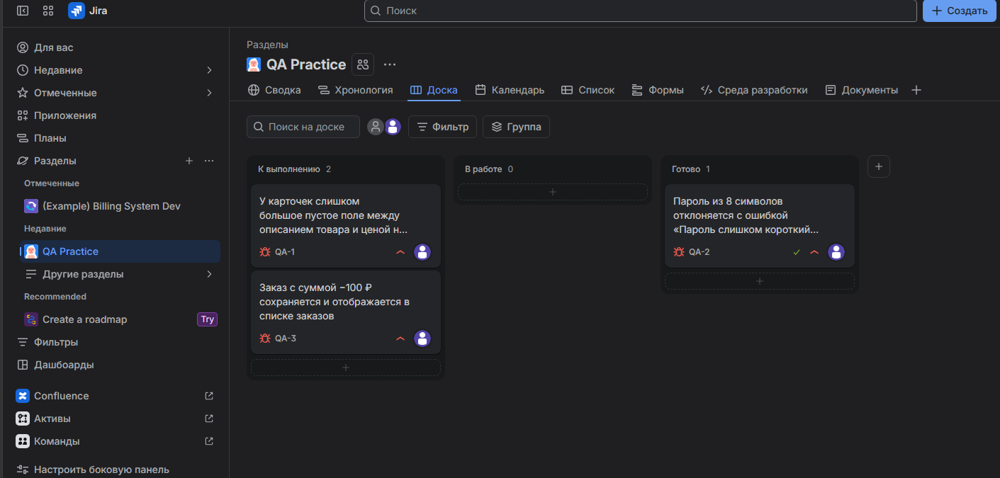
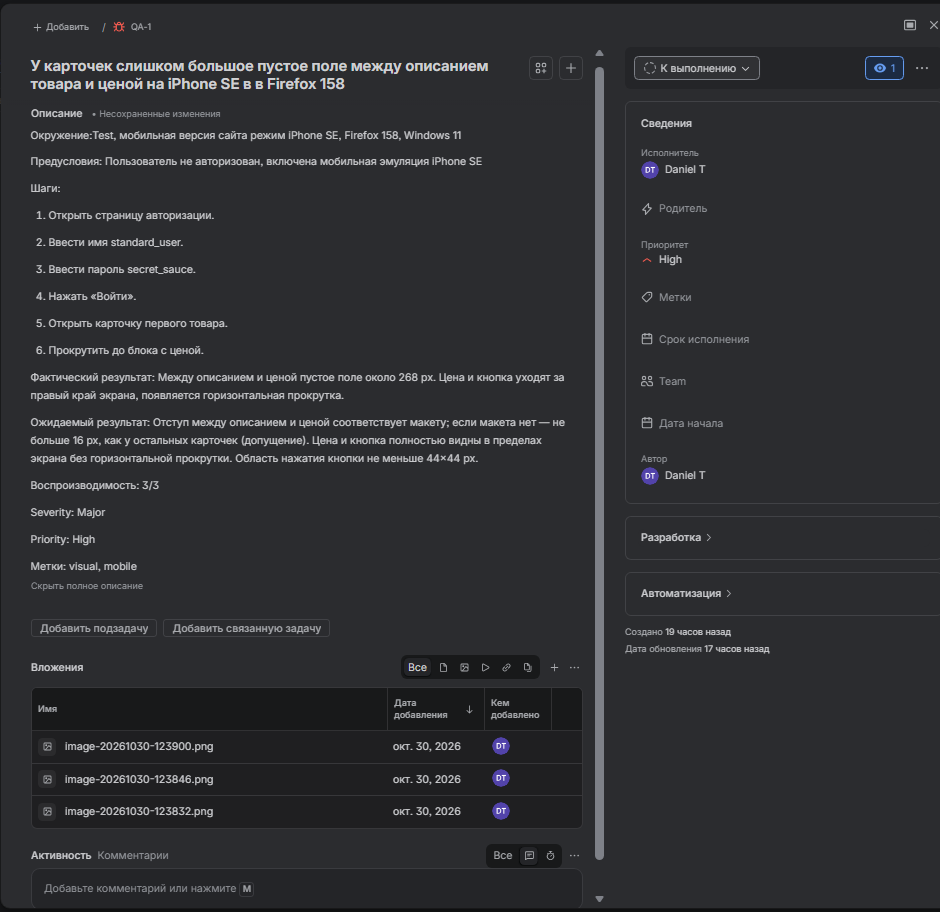
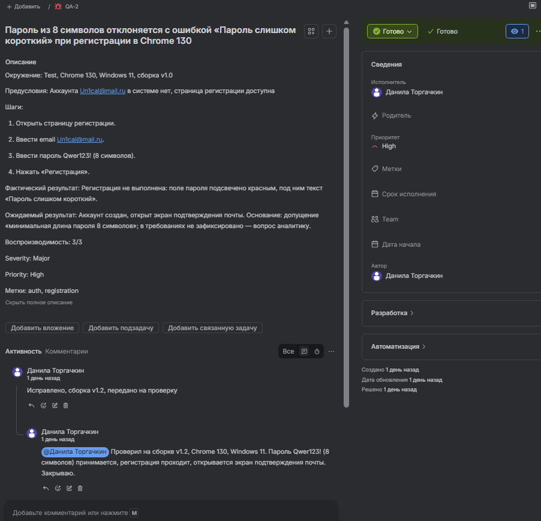
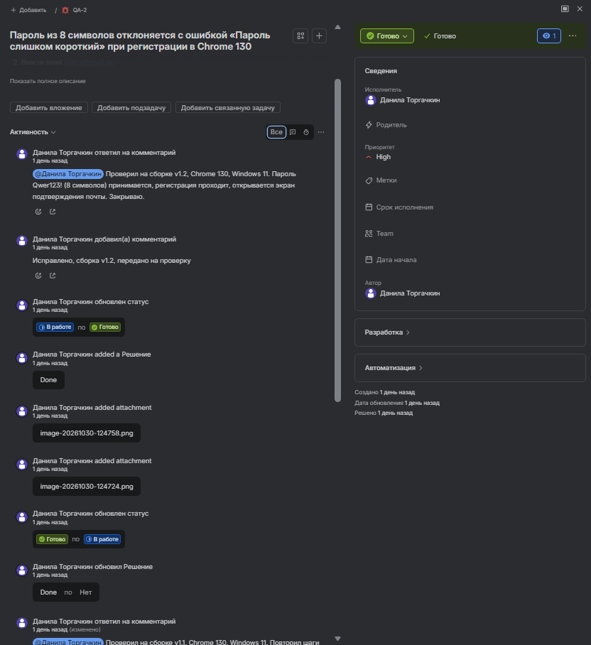
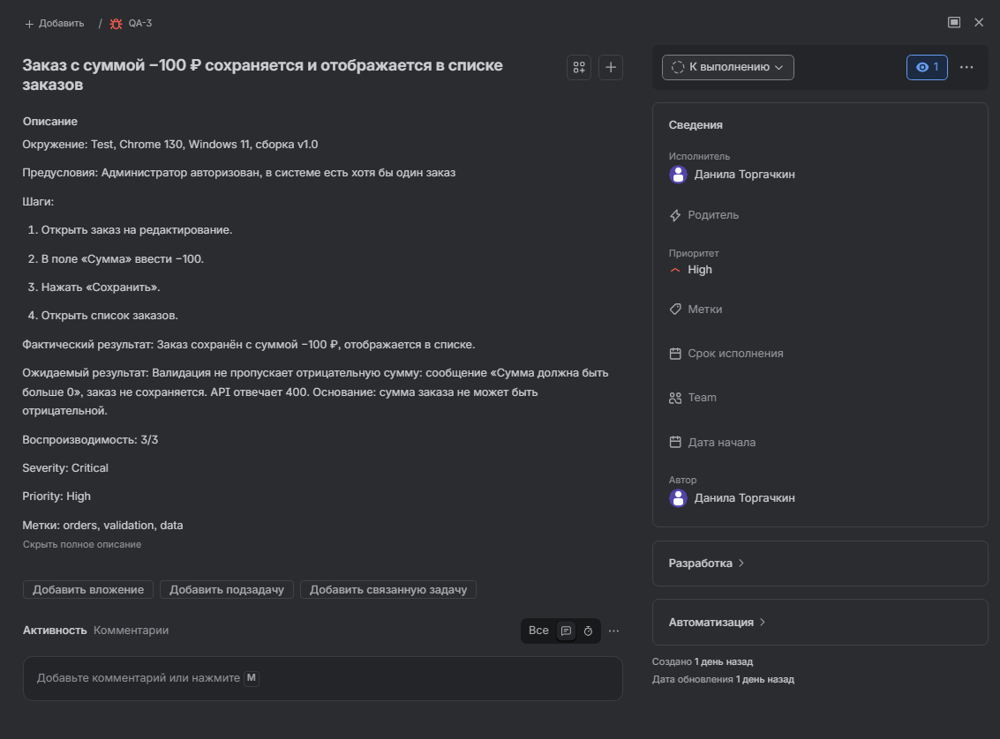
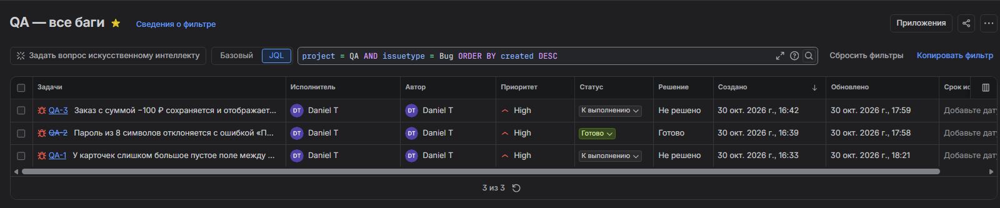
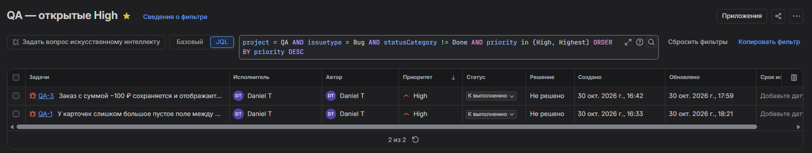

# Jira: практика баг-трекинга

Проект `QA Practice` (Kanban). Три бага, полный цикл статусов с возвратом, три JQL-запроса.

Стенд: `saucedemo.com`, десктоп Chrome 130 и мобильная эмуляция iPhone SE в Firefox 158.

## Доска



---

## Баги

| ID | Заголовок | Severity | Priority | Статус |
| --- | --- | --- | --- | --- |
| QA-1 | У карточек слишком большое пустое поле между описанием товара и ценой на iPhone SE в Firefox 158 | Major | High | К выполнению |
| QA-2 | Пароль из 8 символов отклоняется с ошибкой «Пароль слишком короткий» при регистрации в Chrome 130 | Major | High | Готово |
| QA-3 | Заказ с суммой −100 ₽ сохраняется и отображается в списке заказов | Critical | High | К выполнению |

### QA-1 — визуальный дефект, мобильная версия



- Окружение: Test, мобильная эмуляция iPhone SE (375×667), Firefox 158, Windows 11.
- Факт: между описанием и ценой пустое поле около 268 px, цена и кнопка уходят за правый край, появляется горизонтальная прокрутка.
- Ожидание: отступ соответствует макету (допущение: не больше 16 px, как у остальных карточек), цена и кнопка видны без прокрутки, область нажатия не меньше 44×44 px.
- Воспроизводимость 3/3.

### QA-2 — цикл статусов с возвратом





Прошёл полный цикл: `К выполнению → В работе → Готово → В работе → Готово`.

Возврат из `Готово` — с доказательствами: сборка, окружение, повтор шагов, фактический результат и вложение. Финальное закрытие — только после повторной проверки исправления.

### QA-3 — валидация числового поля



- Факт: заказ сохранён с суммой −100 ₽ и отображается в списке.
- Ожидание: валидация не пропускает отрицательную сумму, показывается сообщение, API отвечает 400.
- Основание: сумма заказа не может быть отрицательной.
- Severity Critical: порча финансовых данных, а не косметика.

---

## JQL

Все баги проекта — 3 задачи:

```
project = QA AND issuetype = Bug ORDER BY created DESC
```



Открытые баги высокого приоритета — 2 задачи:

```
project = QA AND issuetype = Bug AND statusCategory != Done AND priority in (High, Highest) ORDER BY priority DESC
```



Поиск по тексту — 2 задачи:

```
project = QA AND text ~ "пароль" ORDER BY created DESC
```

`text` ищет по всем текстовым полям, включая шаги, поэтому в результат попал QA-1 с шагом «Ввести пароль secret_sauce». Точный поиск только по заголовку:

```
project = QA AND summary ~ "Пароль" ORDER BY created DESC
```

---

## Что показывает этот проект

- Оформление дефекта по шаблону: окружение, предусловия, шаги, факт, ожидание, воспроизводимость, Severity/Priority, метки.
- Ведение дефекта по жизненному циклу, включая возврат из `Готово` с доказательствами.
- Работа с JQL: фильтрация по проекту, типу, категории статуса, приоритету и тексту; понимание разницы между `status` и `statusCategory`.
