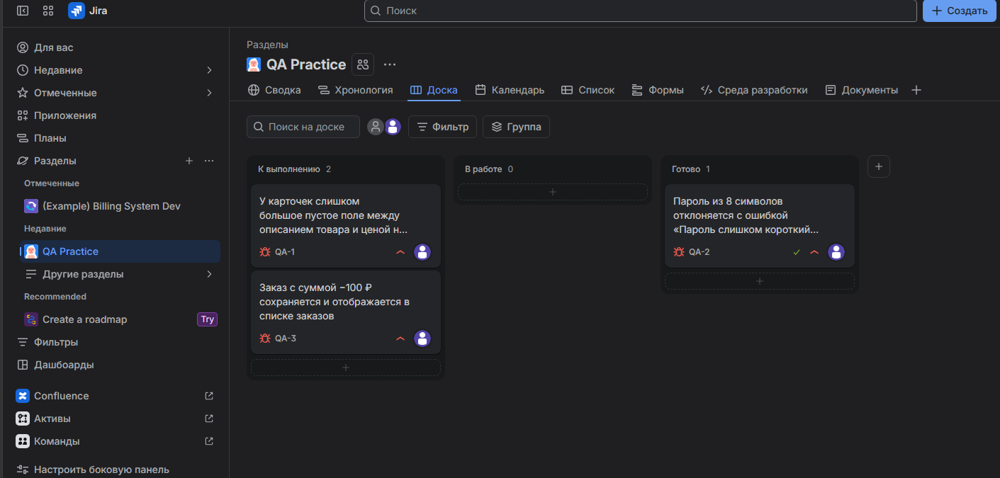
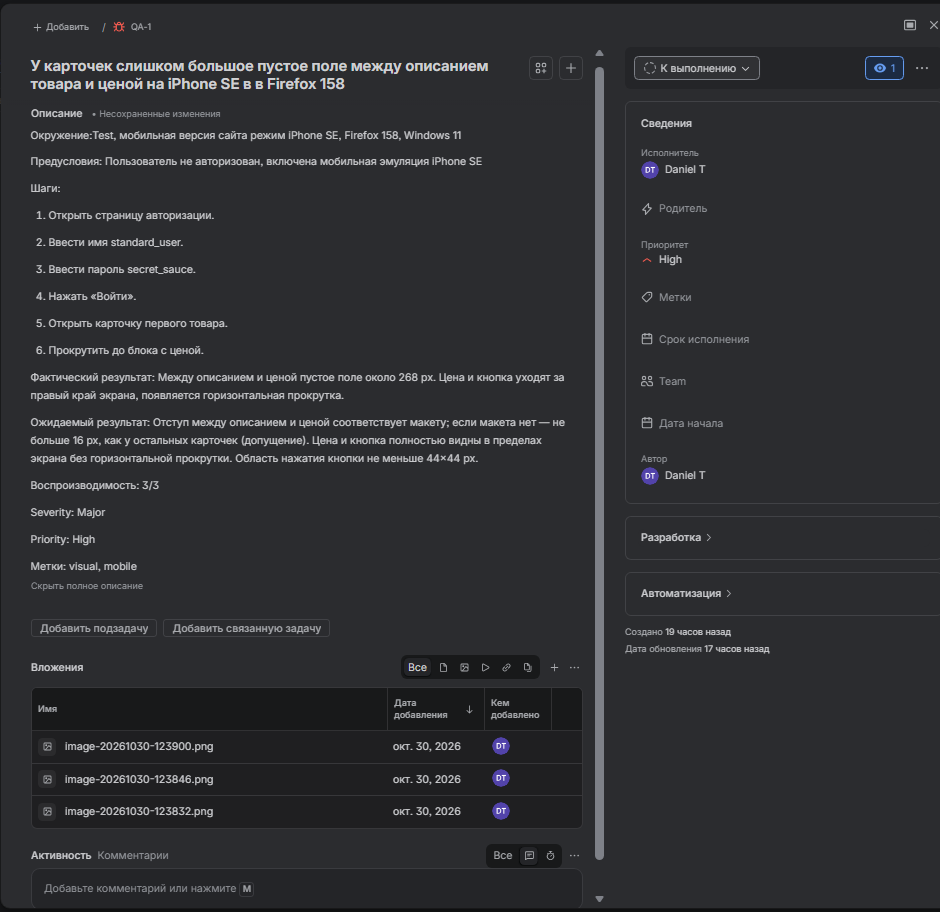
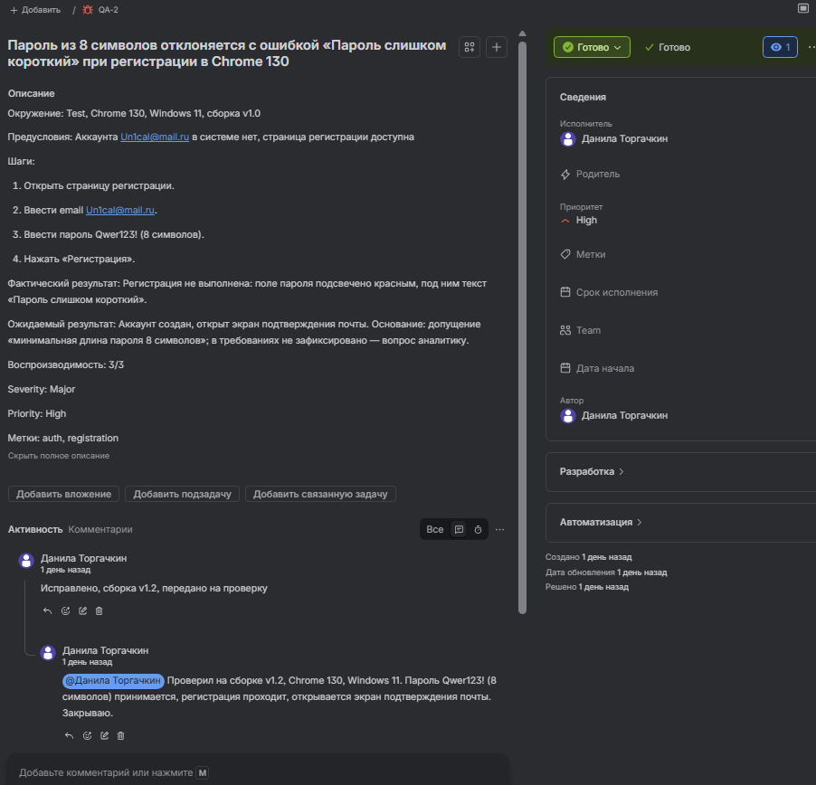
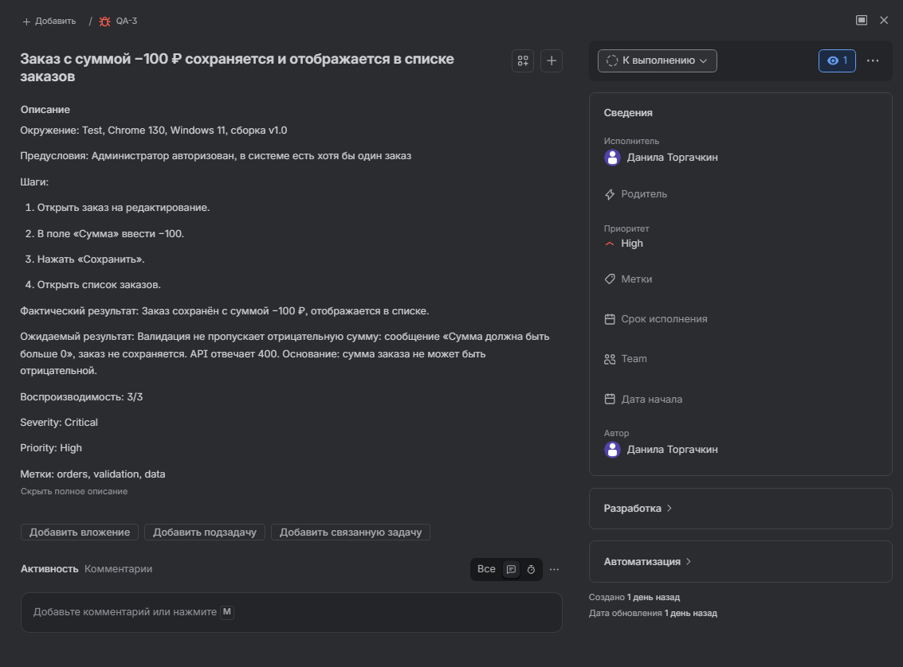
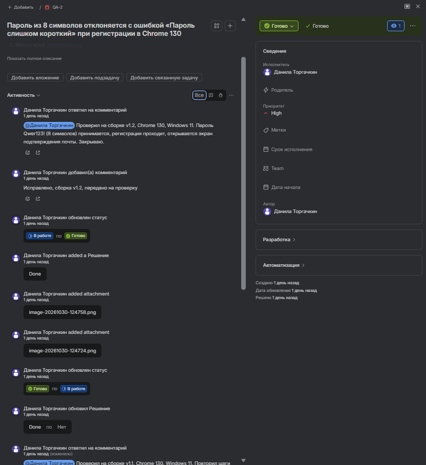
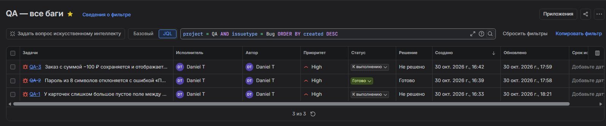
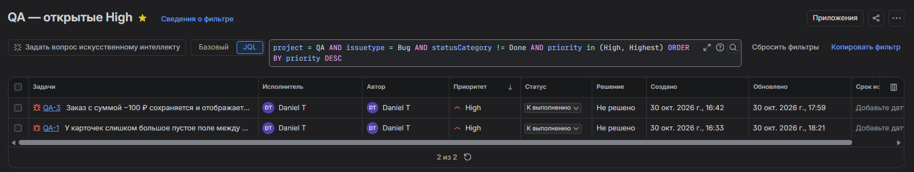

# QA Portfolio — Данила Торгачкин

Стажёр QA Engineer: ручное тестирование web и API.

Здесь учебные артефакты: баг-репорты, чек-листы, Postman-коллекции. Всё сделано на открытых стендах (`saucedemo.com`, `restful-booker.herokuapp.com`), без чужих данных.

**Контакты:** [Telegram](https://t.me/danilka_it) · danila-torgachkin@mail.ru

---

## Что внутри

| Папка / файл | Что это | Инструменты |
| --- | --- | --- |
| [`bug-reports/`](bug-reports/) | Баг-репорты по шаблону: предусловия, шаги, факт, ожидание, Severity/Priority | Markdown |
| [`api/`](api/) | Postman-коллекция `restful-booker`: 8 запросов, авторизация по токену, негативные проверки | Postman, REST, JSON |
| [`saucedemo/`](saucedemo/) | Чек-листы и тест-кейсы по стенду интернет-магазина | DevTools, Markdown |
| [`jira/`](Jira/) | Скриншоты Jira-проекта: 3 бага, цикл статусов с возвратом, JQL-запросы | Jira |

---

## Как открыть коллекцию

1. Скачать [`api/restful-booker.postman_collection.json`](api/restful-booker.postman_collection.json).
2. В Postman: **Import** → выбрать файл.
3. Переменная `baseUrl` = `https://restful-booker.herokuapp.com`.
4. Для `PATCH` и `DELETE` нужен токен: выполнить `POST /auth`, подставить в заголовок `Cookie: token=<значение>`.

Токен в репозитории не хранится — он выдаётся при каждом `POST /auth` и живёт до истечения.

---

## Баг-репорты

| ID | Заголовок | Severity |
| --- | --- | --- |
| [BUG-REG-001](bug-reports/BUG-REG-001-password-8-chars.md) | Пароль из 8 символов отклоняется при регистрации | Major |

---

## Jira

| Что проверяли | Скриншот |
| --- | --- |
| Доска |  |
| Первый баг |  |
| Второй баг |  |
| Третий баг |  |
| Цикл статусов с возвратом |  |
| JQL: все баги, 3 задачи |  |
| JQL: открытые High, 2 задачи |  |

---

## Что дальше

- [ ] Saucedemo: тест-план, 2 чек-листа, 7 тест-кейсов, баг-репорты, итоговый отчёт
- [ ] API: чек-лист на 25 проверок, расширенная коллекция, 5 баг-репортов
- [ ] SQL: 20 задач с запросами и результатами
- [ ] Мобильное тестирование: отчёт по адаптивности
